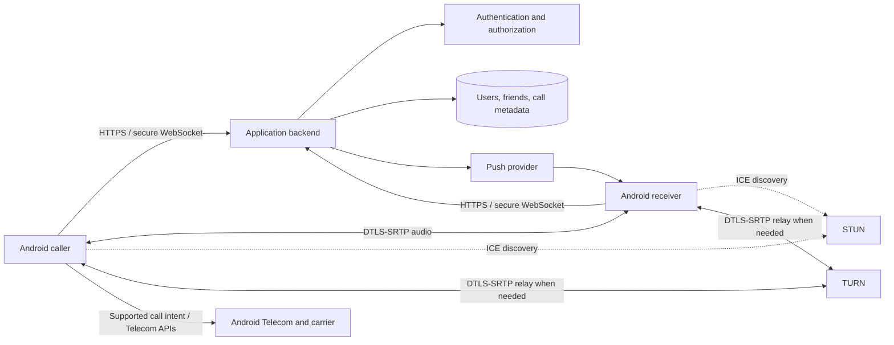
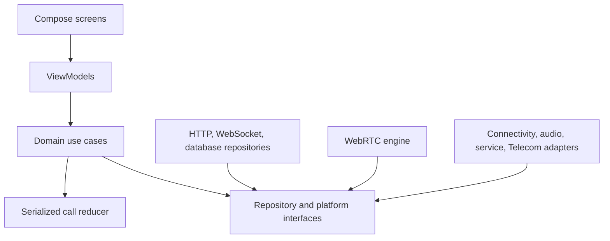
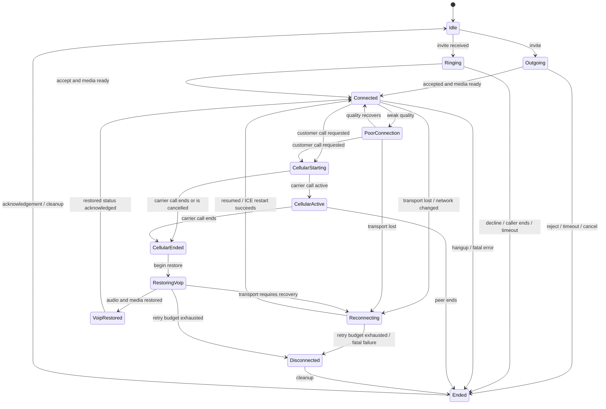
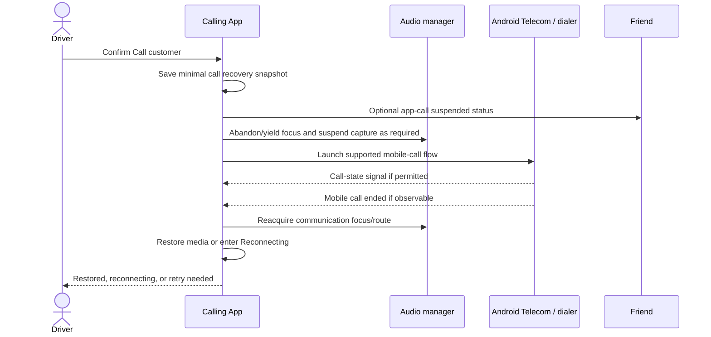

# Architecture

## Design principles

- The logical call is independent of any single WebSocket, ICE transport, Android component, or activity.
- One serialized reducer owns call-state transitions; UI, Telecom events, connectivity, WebRTC callbacks, and notifications submit events rather than mutating state directly.
- Media is peer-to-peer when possible and relayed through TURN when necessary. Signaling and metadata pass through the backend; audio is not stored.
- Android interfaces sit behind adapters so the domain model remains testable and a future iOS client can reuse the protocol.
- Server authorization is authoritative for friendship, blocking, ringing, and call membership.

## System context



WebRTC media is encrypted in transit by DTLS-SRTP. That is transport encryption between WebRTC endpoints/relay; do not market a custom cryptographic guarantee or verified end-to-end identity unless it is separately designed and audited. A TURN server relays encrypted packets and sees network metadata, not clear audio.

## Android boundaries

The Compose UI observes immutable view state from ViewModels. Use cases coordinate repositories and the call-state reducer. Platform adapters own ConnectivityManager callbacks, audio focus/routing, notification channels/actions, foreground-service lifecycle, contacts, and AndroidX Core-Telecom 1.0.1 integration for the app's own calls. The WebRTC engine exposes typed events and commands; it must not navigate or update UI directly.

Recommended dependency direction:



Persist account/session data in encrypted app-private storage backed by Android Keystore. Persist minimal call history in the app database. Active-call recovery state should contain only opaque IDs and timestamps, not audio or customer numbers. Treat OS process death as normal: rehydrate metadata, verify server truth, then recover; never assume that a persisted “connected” flag proves a live peer connection.

## Signaling protocol

Every signaling message should carry a protocol version, message ID, call ID, sender identity (derived server-side from the authenticated connection), event type, monotonic sequence or revision, timestamp, and validated payload. Expected events include invite, ringing, accept, reject, SDP offer/answer, ICE candidate, ICE restart, hangup, heartbeat, and reconnect/resume.

Requirements:

- Authorize both users and block state before forwarding any event.
- Make terminal events idempotent and reject stale revisions.
- Cap payload size and rate; validate schemas at the boundary.
- Never log SDP, ICE candidates/credentials, auth headers, or push tokens in production.
- Use short-lived access tokens, refresh-token rotation/revocation, and secure WebSockets.
- Expire unanswered invites and abandoned call sessions server-side.
- Push wakes the recipient; it is not the source of truth. The app fetches the current call state after wake-up.

## Call state machine

The Android domain implements the brief's stages in `CallStateMachine`, backed by `StateFlow` and a coroutine `Mutex`. A single reducer prevents competing network, WebRTC, Telecom, service, and UI callbacks from mutating state concurrently, and call IDs filter late callbacks from an earlier session.



`PoorConnection` and `VoipRestored` are transient stages in the current implementation; UI/coordinators must advance them when quality recovers or the restore confirmation is shown. The mutex and call-ID guard solve in-process ordering, but production recovery should also persist a backend call revision. Each asynchronous command should carry the call ID/revision so callbacks from an earlier connection or process instance are ignored.

## Network recovery

```mermaid
sequenceDiagram
    participant OS as ConnectivityManager
    participant SM as Call reducer
    participant RTC as WebRTC engine
    participant SIG as Signaling backend

    OS->>SM: validated network lost or changed
    SM->>SM: Reconnecting; start bounded backoff
    OS->>SM: validated internet available
    SM->>SIG: resume(callId, lastRevision)
    SIG-->>SM: authoritative active call state
    SM->>RTC: set preferred network / ICE restart
    RTC-->>SM: connected or failed
    SM->>SM: Connected or next bounded retry
```

Use validated network capability, not merely transport availability. Debounce brief callback churn, add jitter to exponential backoff, stop after the configured retry/time budget, and suspend retries when there is no validated internet. Reset the attempt count only after a stable connected interval. Preserve the logical call ID across reconnects and use the backend revision to avoid duplicate sessions.

## Customer-call sequence



## Android and carrier limitations

- A regular app cannot intercept or mix the cellular call's audio. Microphone access may be revoked or silenced during a mobile call.
- Audio focus, communication device selection, Bluetooth behaviour, and simultaneous cellular/data capability vary by Android version, OEM, carrier, SIM configuration, and vehicle.
- General call-state observation is permission- and role-dependent. Some modern Android capabilities are reserved for the default dialer or a self-managed `ConnectionService`, and Play restricts Call Log/SMS permissions. The app must degrade to user confirmation or lifecycle/audio-focus signals when it lacks legitimate access.
- `ACTION_CALL` requires a dangerous permission; `ACTION_DIAL` delegates confirmation to the system dialer and is usually the least-privilege choice. Neither guarantees reliable end-of-call callbacks.
- Self-managed calling integrates the app's own call with Telecom; it does not confer control over carrier calls. It also adds manifest, user-experience, foreground-service, and incoming-call obligations that must be tested on every supported API level.
- Android 13+ notifications require runtime consent. Android 14+ foreground-service types/permissions are enforced. Full-screen intents and lock-screen presentation are policy-restricted and must be used only for genuine incoming calls.
- Android background-start, battery, and OEM process-management policies can delay incoming-call presentation or terminate the app. Push delivery is best effort, not a real-time guarantee.
- WebRTC cannot transmit without a usable network. Seamless Wi-Fi/mobile handover is an attempt, not a guarantee; NAT rebinding frequently requires ICE restart or TURN.
- On some mobile networks, a voice call may reduce or remove packet data. Signaling can be restored only when connectivity returns.

The supported implementation must surface these limitations rather than using accessibility automation, hidden APIs, root, call-log workarounds, or claims that app audio will always coexist with a carrier call.

Platform references: [Android foreground-service types](https://developer.android.com/about/versions/14/changes/fgs-types-required), [Android foreground-service changes by version](https://developer.android.com/develop/background-work/services/fgs/changes), and [Play full-screen-intent requirements](https://support.google.com/googleplay/android-developer/answer/13392821).

## Security and operations

Use TLS for all APIs and secure WebSockets for signaling. Rate-limit authentication, invites, call setup, reporting, and reconnect traffic by account plus coarse network signal. Encrypt secrets at rest, rotate signing and TURN credentials, use time-limited TURN credentials, and isolate production/staging projects. Operational dashboards may show aggregate counts and quality distributions only; access to user-level metadata must be audited and least-privilege.

Do not store call audio. Store only the minimum call record: participants, timestamps, result/reason, duration, coarse quality summary, and reconnection count. Keep customer numbers out of server call history by default.
